# 换机械臂模型：验收报告

写于 2026-11-14。分支 `feat/model-swap`（从 `feat/panel-demo` 开出），只在本机提交，没有 push，没有动 main，没有连接任何真机、相机、激光或另一台主机。

## 1. 一句话总览

| 项 | 状态 | 一句话 |
|---|---|---|
| 合入视觉主题 | 已完成 | `feat/panel-visual` 合入 `feat/panel-batch1`（合并提交 `b911c54`），合并后 110 项测试通过 |
| P0-1 换机械臂模型 | 已完成 | 6 关节 + 自制夹指，末端换算与调研报告 7 组数据一致；相机、激光、轨迹都挂在夹爪上 |
| P0-2 接口文档 | 已完成（草案） | `docs/接口文档.md`，面板用到的字段全部由测试自动核对；第 12 节如实列出实现与设计还有的差异 |
| P0-3 首页内容替换 | 已完成 | 布局不动，七个区域换成轨迹训练内容；`?legacy=1` 是旧首页 |
| P0-4 模拟数据 | 已完成 | 不加参数就用浏览器内的模拟主机，偏差逐遍从 18 mm 降到 2.5 mm |
| P1 路演模式检查 | 已完成 | 两种分辨率最小字号 18 px、一屏放下、无截断 |
| P2 遥控面板 | 只写方案 | `docs/model-swap/遥控面板方案.md` |
| P3 自主优化 | 已完成 5 条 | 偏差图整数刻度、数据格副行、事件每遍一行、激光按钮样式、手眼画面阈值圈；清单见 `P3-优化清单.md` |

## 2. 每项改了什么、谁做的

分工：Claude 设计、拆任务、验收；Codex 改代码。每个任务的说明和 Codex 的交付说明都在 `docs/model-swap/tasks/`。总体设计在 `docs/model-swap/设计.md`，所有取舍在 `docs/model-swap/决策日志.md`（M1–M8）。

| 提交 | 内容 | 谁做的 |
|---|---|---|
| `f38ce81` | 开工前的现有改动（讲解引导、夹爪模型、照片、调研报告、目标文档） | Codex |
| `b911c54` | 视觉主题合入 `feat/panel-batch1`（在 `feat/panel-batch1` 上） | Claude（Codex 的沙箱建不了 git 工作树） |
| `f580891` | 机械臂参数单一来源 `modules/arm/`、6 轴正运动学入口、孪生显示 J1–J6 | Codex 实现，Claude 设计 |
| `9186e0a` | 夹爪换成自制矩形夹指：STEP 转网格脚本、一白一灰、对称开合，`?gripper=official` 切回 | Codex；Claude 备转换工具环境 |
| `c029636` `86039ed` | 孪生里的相机与视锥、激光头与光束、示范路径虚影、本遍路径、节点、光点与偏差 | Codex；Claude 调整整臂取景 |
| `3633626` | 模拟主机、真主机数据源、状态归并、指标、激光守护 | Codex 实现，Claude 定规格 |
| `25a25b0` | 首页内容替换（认领机制） | Codex；Claude 改了模拟示范不该自动结束的问题 |
| `23dd93b` | 验收打回的 8 个显示问题；孪生标签停在左上角盖住状态芯片 | Codex 改 8 条；Claude 找到并修了标签问题的根因 |
| `ca13dca` | 接口文档 v1 与字段核对测试 | Codex 起草，Claude 验收 |
| `fabcafe` | 接真机前的五处逻辑修补：激光告警不跨时钟比较、激光时长以主机为准、静默超时重连、无效测量清掉旧光点、达标口径与主机一致 | Codex（交付说明写到一半额度用完，代码和文档已完成）；Claude 浏览器复核 |

### 关键做法

- **旧页面怎么保住**：旧的 3 关节 `app.js` 不拆，只加一个“认领”接缝；新模块 `modules/trainer/` 声明接管哪些区域，旧代码就跳过那些区域。新模块加载失败或被删掉，页面自动退回旧版。所以 `index.html` 一行没改、旧测试一个没改，`?legacy=1` 就是原来的首页。
- **参数只有一份**：`modules/arm/arm-params.js`。关节卡片、孪生、模拟主机、测试都从这里读。
- **末端换算**：保留原来的正运动学连乘，另开 6 轴入口，不夹限位、不补 0；缺轴、越界、断线的帧会把轨迹断开。末端分成 `end_link`、夹持中心、相机、激光四个，后三个都是在 `end_link` 后面右乘固定变换。0.2 m 的安装台只在画面里，不进换算。
- **时间统一**：面板和主机之间一律 Unix 毫秒（主机时钟）。

### P3 自主优化

清单和理由在 `docs/model-swap/P3-优化清单.md`，每条一个提交，前后对比图在 `screenshots/p3/`（文件名 `数字-before-*`、`数字-after-*`）。

| 提交 | 改了什么 | 一句话理由 |
|---|---|---|
| `5d2b1b1` | 偏差曲线纵轴刻度取整：0、5、10、15、20 | 原来 22.6 / 16.9 / 11.3 这样的刻度得心算 |
| `1a43b84` | 数据格副行：空闲只在第一格写下一步；“第 4 遍已完成 · 练习中”；修正格写“第 4 遍：J1 4 处，最大 −0.20°” | 四格是视觉焦点，原来四格重复同一句提示、遍数和偏差对不上 |
| `18cee67` | 最近事件每遍合成一行 | 原来每遍两行，把示范、急停等早先事件挤出去 |
| `35526d5` | 激光按钮关着时用普通样式，只有打开或正在出光时才用琥珀色 | 琥珀色表示“注意”，关着的激光不该最抢眼 |
| `478e464` | 手眼画面以示范光点为圆心画 5 mm 阈值圈，圈内青色、圈外红色 | 让人看出“偏了多少算多” |

全部由 Codex 实现，Claude 逐条在浏览器里截图验收；没有打回。

## 3. 截图

都在 `docs/model-swap/screenshots/`。

| | 改前 | 改后 |
|---|---|---|
| 首页 1920×1080 | 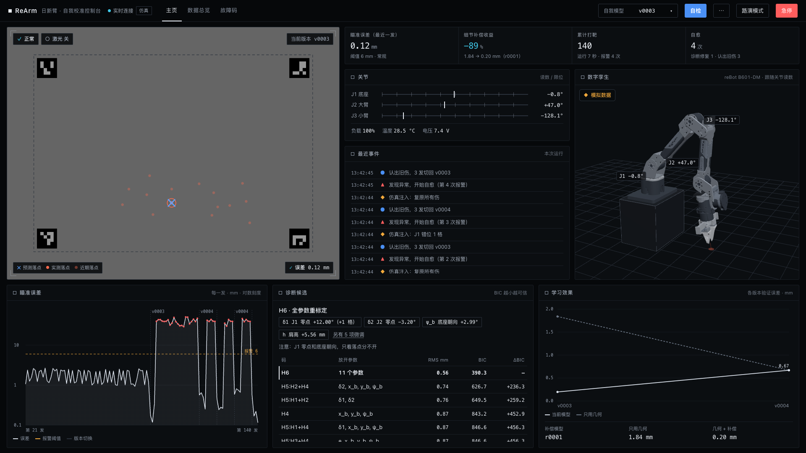 | 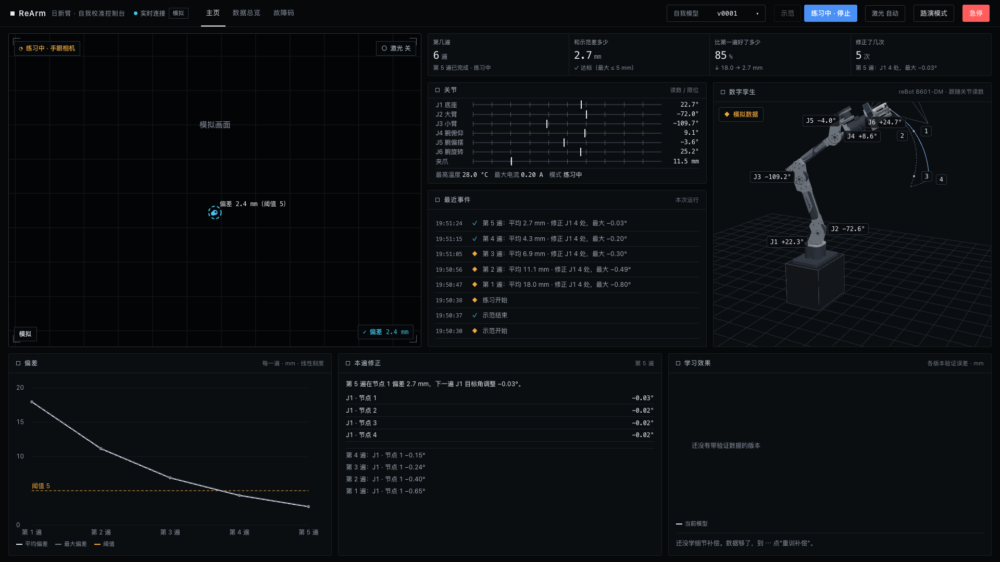 |
| 首页 1280×720 | 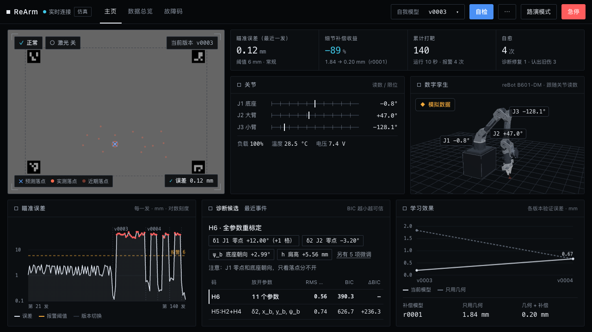 | 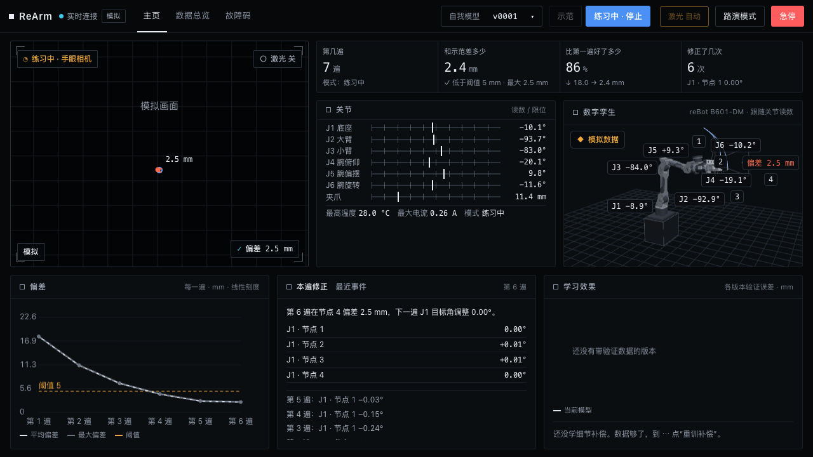 |
| 路演 1920×1080 | 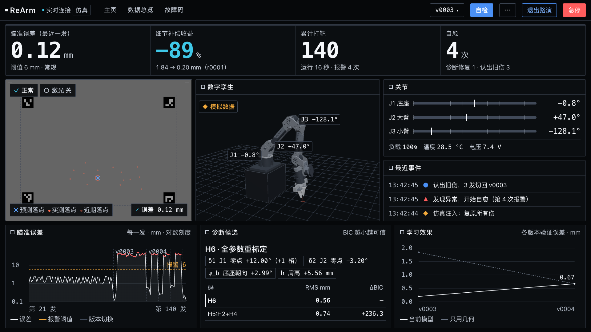 | 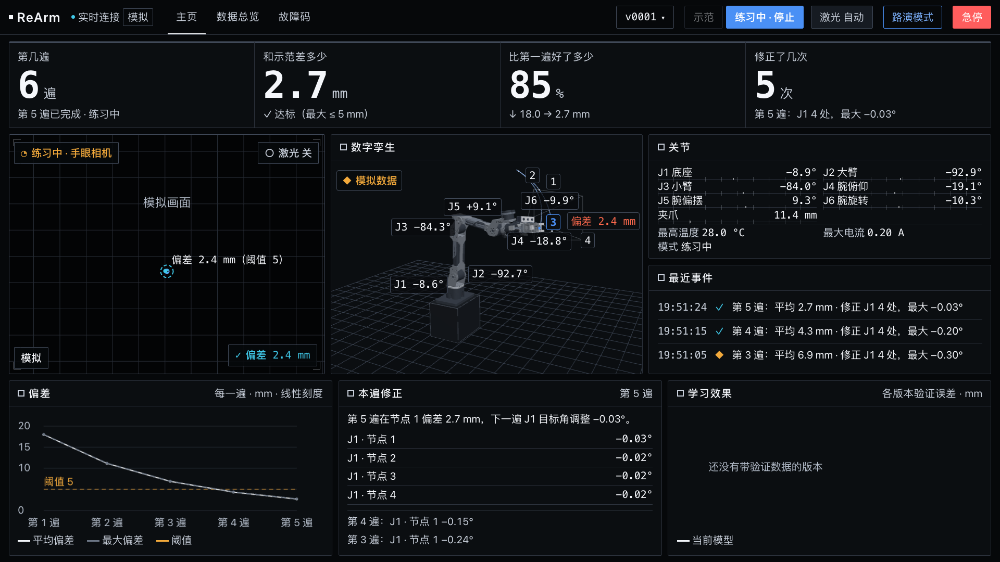 |
| 路演 1280×720 | 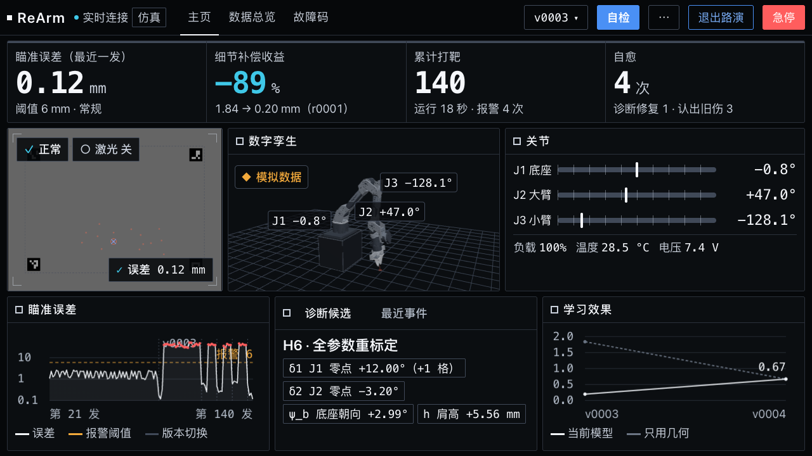 | 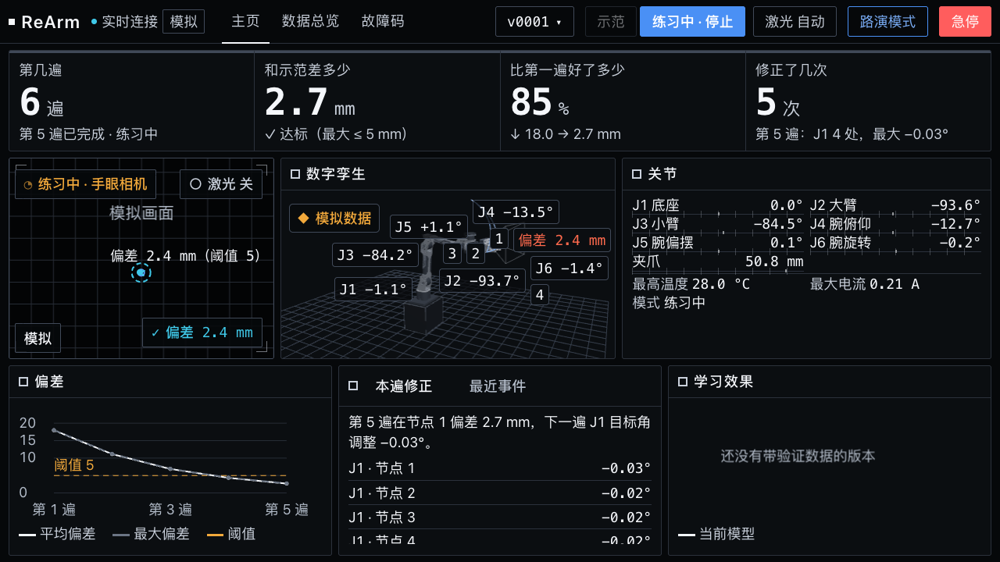 |

其它：

- 刚打开、还没示范：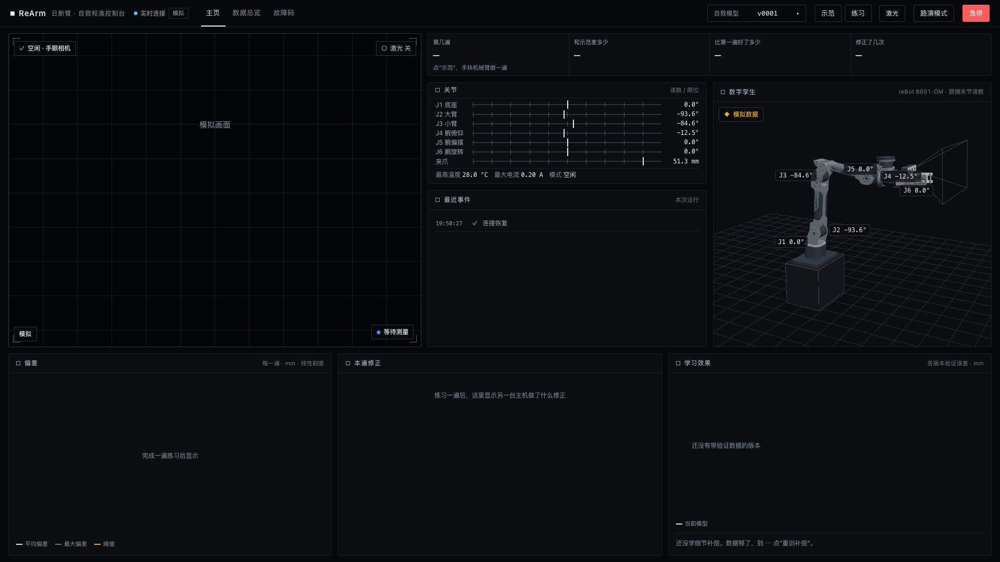
- 示范进行中：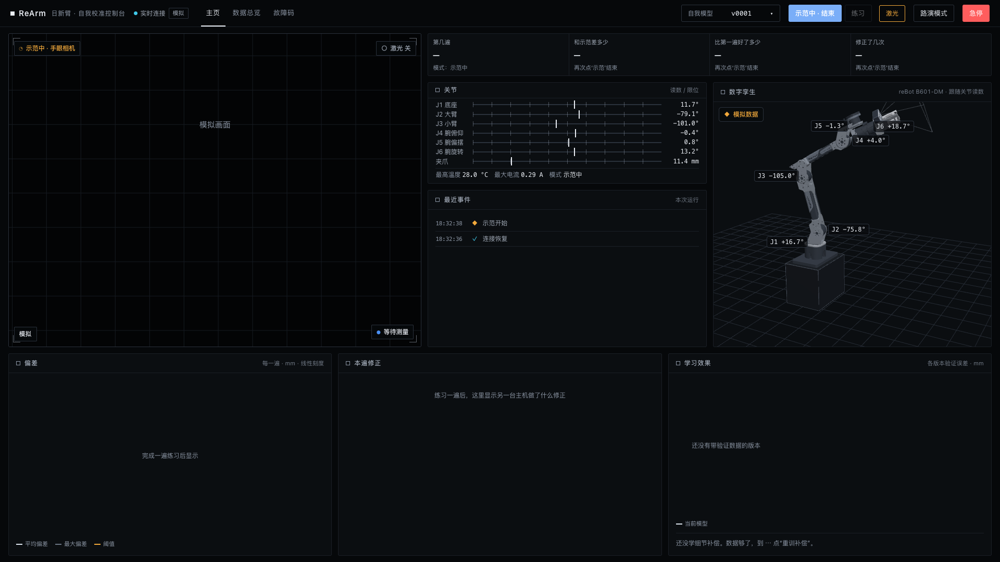
- `?legacy=1` 旧首页：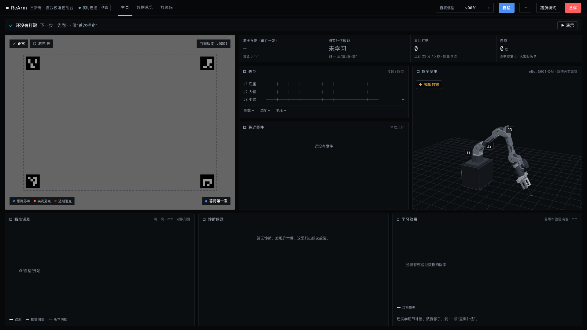
- 主机连不上（离线、按钮全禁用、不回退模拟）：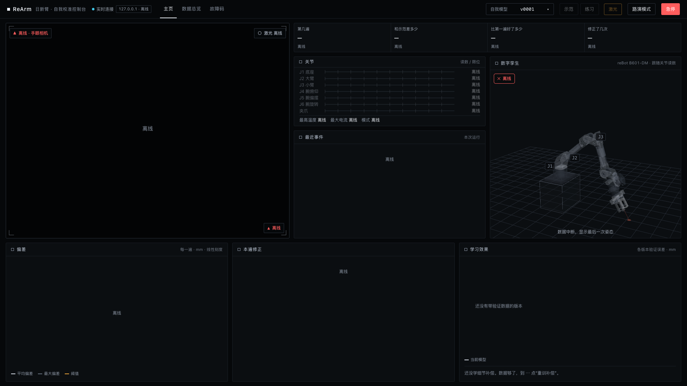
- 夹爪近景，闭合：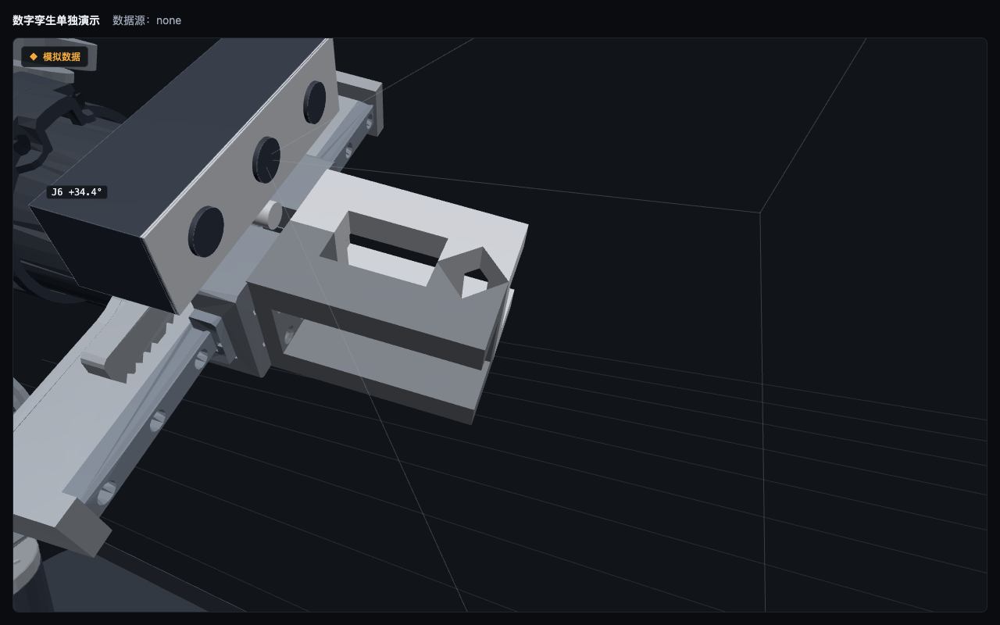　全开 57 mm：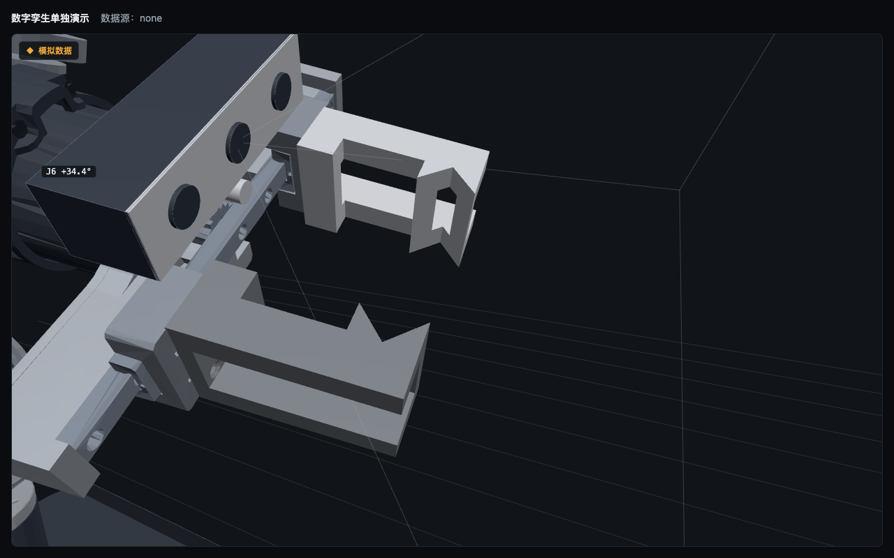
- 夹爪上的相机、视锥、激光束、示范路径与偏差标签：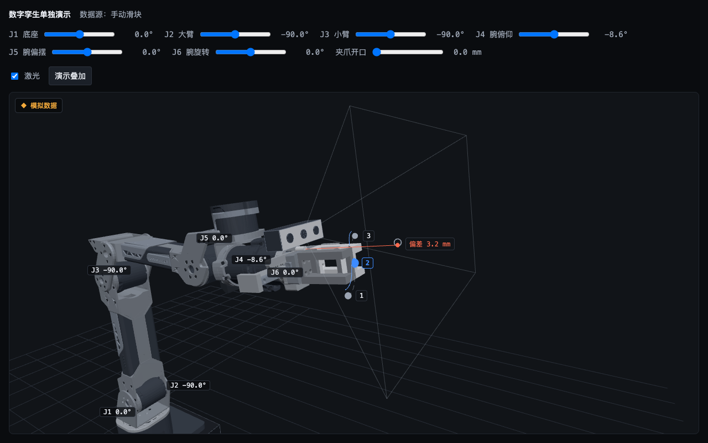

## 4. 测试结果

`.venv/bin/python -m pytest -q`：**324 通过，0 失败**。开工时 156 项（`feat/panel-demo`），新增 168 项，旧测试一项未删未改（只有两处测试期望随设计变化更新，见提交说明）。

浏览器验收（无头 Chromium，模拟数据，本机 127.0.0.1）：

| 检查 | 结果 |
|---|---|
| 示范 → 结束 → 练习，偏差逐遍下降 | 第 1–8 遍平均 18.0 / 11.1 / 6.9 / 4.3 / 2.7 / 2.4 / 2.5 / 2.5 mm，比第一遍好 86 % |
| 示范与练习互斥；练习中激光手动开关禁用并显示“自动” | 通过 |
| 6 个关节和夹爪在关节卡片与孪生里显示，角度与输入一致 | 通过（越界帧保持上一姿态并提示“J2 越界”） |
| 末端换算与调研报告 7 组数据对照 | 最大差小于 0.0006 mm（测试） |
| 相机跟着夹爪动 | 通过（测试与截图） |
| 两根夹指开合左右对称、闭合不穿模 | 通过（网格测试与近景截图） |
| `?legacy=1` 旧首页 | 通过，旧测试全部保留 |
| `?backend=ws://127.0.0.1:9/ws`（连不上） | 显示离线、训练按钮全禁用、不回退模拟 |
| 路演模式 1920×1080 / 1280×720 | 最小字号 20 / 18 px，无页面滚动，无截断，无卡片溢出 |
| 日常模式 1920×1080 / 1280×720 | 无页面滚动，无截断，无卡片溢出；最小字号 11 px（顶栏的旧标签） |
| 无效测量（激光没打开） | 画面显示“未找到光点”，旧光点和孪生上的光点都清掉：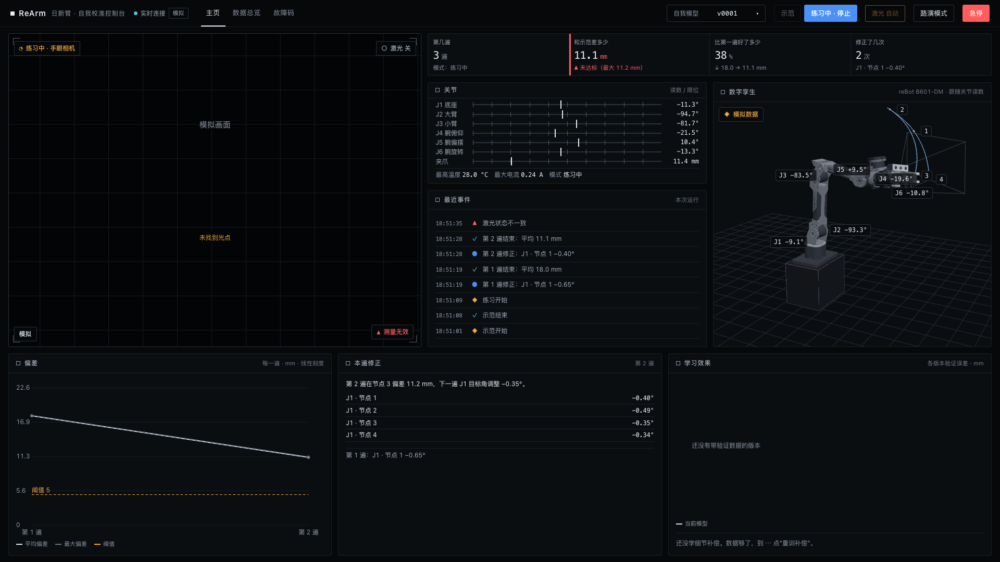 |
| 练习中点“急停” | 面板依次发出 `estop`、`laser_off`，三个训练按钮全部禁用 |
| 页面脚本报错 | 0 |

没有验证的：真机、真相机、真激光、真主机；投影仪上的观感；手机宽度。

## 5. 需要你决定的事项（按重要程度）

1. **夹爪 STEP 的尺寸对不上**。实测 `hardware/gripper/机械臂夹具.STEP` 是 25 × 40 × 65.5 mm，不是目标文档里写的约 49 × 80 × 67 mm。我按实测做了。请确认文件就是现在装在机械臂上的那一版。（M5）
2. **对应不上的旧卡片怎么处理**。推荐：
   - **学习效果卡片**（首页右下）：换成“每个节点的偏差”（4 个节点 × 最近几遍的小表或条形图），数据现成在 `node_result` 里。现在它显示“还没有带验证数据的版本”，路演时显得空。**推荐换掉。**
   - **版本下拉**（顶栏）：讲的是旧的 3 关节自我模型版本，新流程用不上。推荐 `?legacy=1` 以外隐藏。
   - **数据总览页**：换成“历次练习”（每次示范一行：遍数、首遍和末遍偏差、用时），推荐下一轮做。
   - **故障码页**：旧的 H1–H6 几何故障码与新流程无关，推荐换成接口文档里的错误码表。
   这几项都是“删卡片 / 改导航”，按规则只写方案，等你定。
3. **偏差按平均还是最大判达标**。主机的 `pass_result.below_threshold` 按最大偏差判，面板改为跟它一致（T6）；主数字仍显示平均偏差。如果你希望按平均判，告诉我，改一处。
4. **相机、激光、夹持中心的安装位置**都是照片估算或占位，在 `arm-params.js` 里标明了。装好激光、做完手眼标定后只改那一个文件。

## 6. 转给另一台主机确认的问题（可以直接转发）

完整清单在 `docs/接口文档.md` 第 14 节。最要紧的几条：

1. 走局域网还是直连？主机的 IP 和端口是多少？面板用 `?backend=ws://主机:端口/路径` 连接，指令发到同一主机的 `POST /api/v1/command`，需要允许面板所在源的跨域。
2. 消息里的时间 `t` 用主机时钟的 Unix 毫秒，主机是否对过时？
3. 关节角零位和正方向由主机换算成 URDF 约定（rad）再发给面板，面板不再转换——请确认由你们保证。
4. 相机型号（照片看像 RealSense D435）和取流方式（默认 MJPEG）。
5. 激光开关状态有没有实际检测？`laser_state.source` 填 `sensed` 还是 `software`。
6. 激光指令带有效时长（默认 3 s），面板每秒续期；主机收不到续期必须自行关光，急停和断线时也必须关。
7. 节点怎么分段（默认由主机自动分）、练几遍（由主机决定）、偏差算二维还是三维（接口按三维）。
8. 示范时怎么取得每个节点的“示范光点”基准（示范时激光开不开、谁来开）。

## 7. 怎么启动、怎么看

```bash
cd /Users/superpanda/Documents/ReArm上位机
```

```bash
git checkout feat/model-swap
```

```bash
.venv/bin/python -m rearm.ui.server --sim --nongeometric --data-dir runtime/panel-demo
```

- 模拟数据（默认）：<http://127.0.0.1:8000/> → 点“示范”，等机械臂走完，再点“示范中 · 结束”，然后点“练习”。大约每 9 秒一遍。
- 接真实主机：<http://127.0.0.1:8000/?backend=ws://主机:端口/路径>（连不上就显示离线，不会回退到模拟）。
- 旧版首页：<http://127.0.0.1:8000/?legacy=1>
- 路演模式：任一地址加 `mode=show`，例如 <http://127.0.0.1:8000/?mode=show>
- 孪生单独看：<http://127.0.0.1:8000/static/modules/twin/demo.html?source=manual&view=gripper>（6 个关节和夹爪滑块，“激光”和“演示叠加”按钮）
- 换回官方尖头夹指对比：地址加 `gripper=official`
- 注意：8000 端口上正在跑的面板服务直接读仓库里的前端文件，切到这个分支后刷新页面就是新首页，不用重启服务。
- 跑测试：

```bash
.venv/bin/python -m pytest -q
```

- 重新生成夹爪网格（需要临时环境里的 gmsh，命令写在脚本头部）：`scripts/build_gripper_mesh.py`
