# 晨间验收报告

> 本文件在夜间分阶段更新。当前版本写于 P0、P1 完成之后；P2、P3 的结果见文末“更新记录”。

## 1. 一句话总览

| 项 | 状态 | 说明 |
|---|---|---|
| P0-1 数字孪生 | 已完成 | 按 B601-DM 官方参数建模，关节角驱动，数据源可替换，带离线提示 |
| P0-2 路演模式 | 已完成 | 两种分辨率、三个页面：最小字号 ≥ 18px，一屏放下，无截断 |
| P0-3 接口文档 | 已完成（草案） | `docs/下位机接口文档.md`，前端字段全覆盖，通信方式待你确认 |
| P1 ADHD 友好 | 已完成 | 状态三重编码、动效收敛、按阶段引导注意力、文案缩短 |
| P2 视觉升级 | 进行中 | 见更新记录 |
| P3 自主优化 | 未开始 | 见更新记录 |

全部改动都在本机分支上，**没有 push，没有合并到 main，没有改写历史，没有连接真实硬件**。

## 2. 每项改了什么（分支 `feat/panel-batch1`）

| 提交 | 内容 |
|---|---|
| `1e0e355` | 开工前的现有改动单独提交（第二、三批） |
| `a7f3139` | 字号、间距抽成 design tokens（`tokens.css`）；主程序增加给模块用的事件钩子 |
| `40a6928` | **P0-1** 数字孪生 `modules/twin/` + 数据源层 `modules/datasource/` + 装配入口 `modules/main.js` |
| `214e5b5` | **P0-2** 路演模式 `modules/presentation/` |
| `def4095` | 模拟下位机脚本 `scripts/mock_device.py` |
| `7c73905` | **P0-3** `docs/下位机接口文档.md` 与字段覆盖测试 |
| `1cb0498` | P1 准备：页面阶段钩子、文案缩短 |
| `66d40cf` | 模型换上官方网格压缩后的真实外形（失败时退回简化外形） |
| `1c95dba` | **P1** 专注阅读模块 `modules/focus/` |
| `1a78cdb` | 验收脚本 `scripts/ui_check/` 与对比截图 |

### P0-1 数字孪生

- 模型：实物核实为 Seeed reBot Arm B601-DM，按它的官方 URDF 参数建模；参数集中在 `modules/twin/arm-config.js`，占位项都标了“占位”。
- 驱动：上位机现有的 J1–J3 读数驱动前三个关节（J4–J6 固定）。测试核对了“大臂仰角 = J2、小臂仰角 = J2 + J3、偏航 = J1”，误差小于 0.2°。
- 状态提示：左上角显示 实时／模拟数据／离线（颜色 + 图标 + 文字）。断线后模型变暗并写明“数据中断，显示最后一次姿态”。
- 数据源可替换：地址栏 `?twin=sim`（内置模拟）、`?twin=device&device=ws://…`（下位机）、缺省用面板数据。已用模拟下位机端到端验证：换数据源时孪生模块零改动，下位机退出后 1 秒内转为离线。
- 可删除：逐个屏蔽 孪生／three.js／数据源／路演／全部模块，主面板都照常运行、无报错。没有 WebGL 时自动改画 2D 侧视简图。
- 位置：首页右栏，关节和最近事件各让出一半宽度，模型占右半（理由见决策日志 D6）。

### P0-2 路演模式

- 打开：地址栏加 `?mode=show`，或点顶栏“路演模式”按钮。
- 四个数据格通栏置顶，数字 1080p 约 71px、720p 约 48px。
- 实测（脚本量出，不是目测）：

| 页面 | 1920×1080 最小字号 | 1280×720 最小字号 | 页面滚动 | 文字截断 |
|---|---|---|---|---|
| 主页 | 20px | 18px | 无 | 无 |
| 数据总览 | 20px | 18px | 无 | 无 |
| 故障码 | 20px | 18px | 无（卡片内滚动） | 无 |

- 版本下拉、版本详情、确认框在两种分辨率下都完整落在屏幕内。
- 日常模式不受影响：路演样式的每条规则都限定在路演模式下，有测试保证。

### P0-3 接口文档

- 推荐方案：USB 串口，每帧一行 JSON + CRC16。文档含选型对比、帧格式、遥测字段表、指令与应答、心跳超时、安全急停、错误码、20 条带真实 CRC 的示例、133 行“前端展示项 ↔ 字段”对照表、14 项待确认事项。
- 验收：测试自动抽取 `app.js` 里用到的全部 24 个状态字段，逐个核对都在文档里；示例帧的 CRC 逐条重算一致。

### P1 ADHD 友好阅读

见决策日志 D13。要点：状态都用“颜色 + 图标 + 文字”；闪烁改为缓变并去掉发光；自愈进行中时摄像头描边、无关卡片变淡；急停时横幅变实心红底、其余变淡；文案缩短。

## 3. 前后对比截图

都在 `docs/overnight/screenshots/`。

| 对比 | 改动前 | 改动后（日常模式） | 改动后（路演模式） |
|---|---|---|---|
| 主页 1920×1080 | 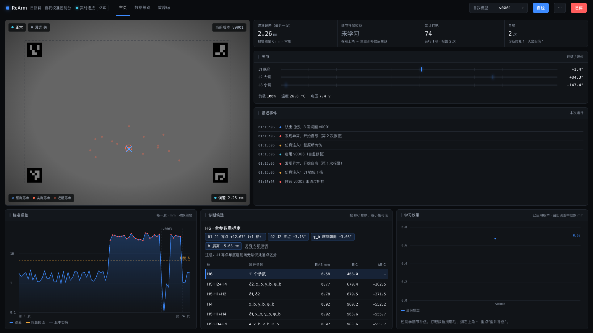 | 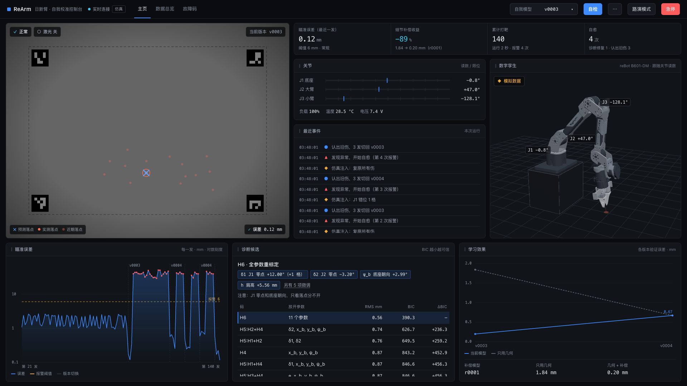 | 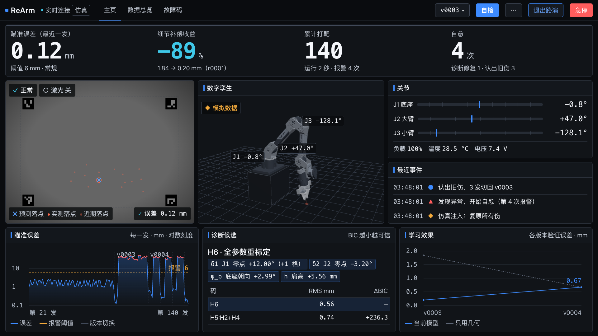 |
| 主页 1280×720 | 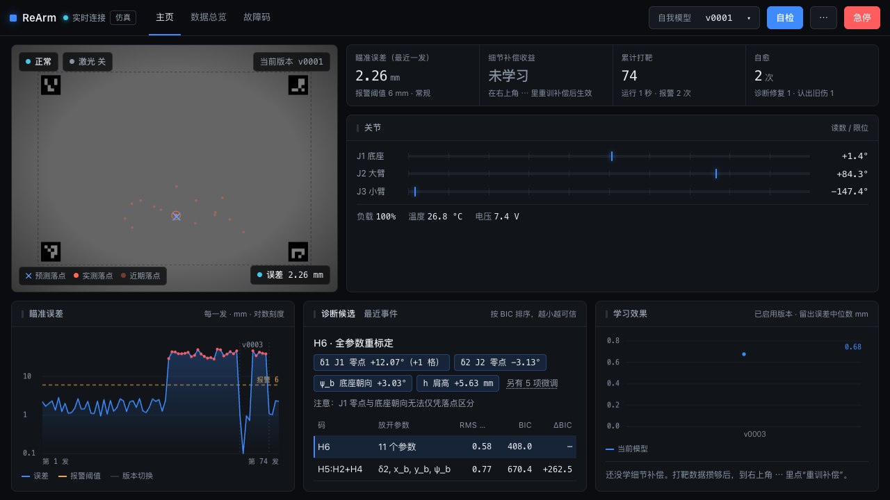 | 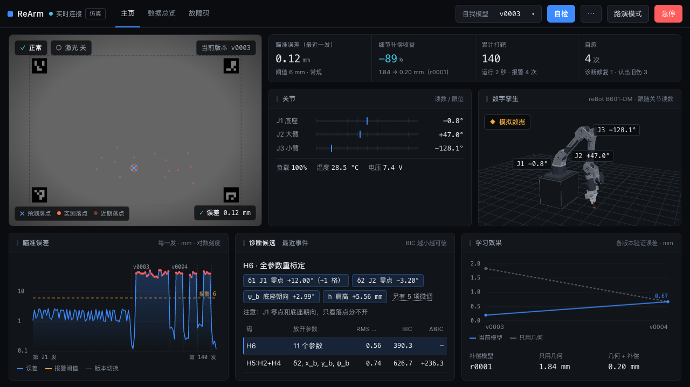 | 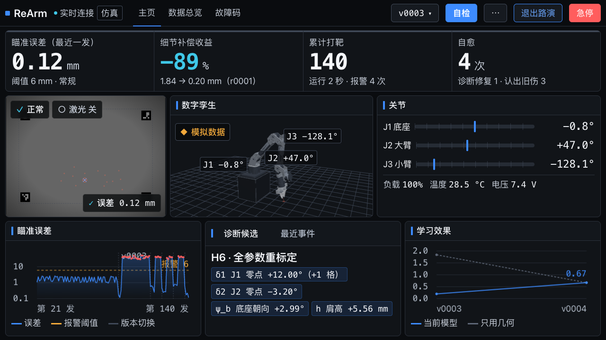 |
| 数据总览 1920×1080 | 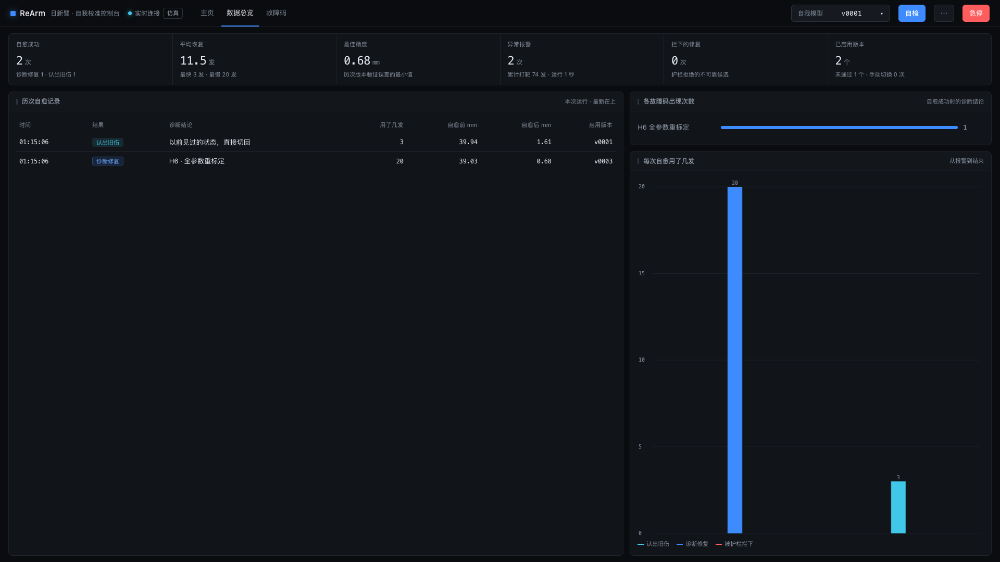 | 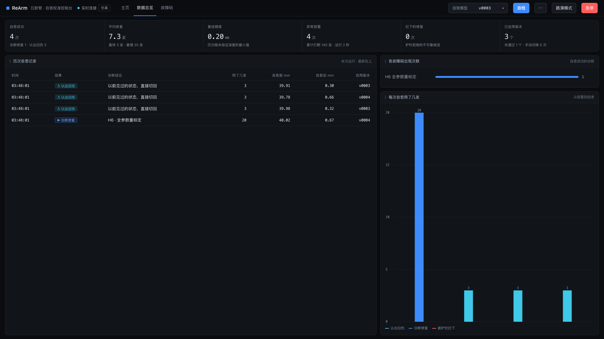 | 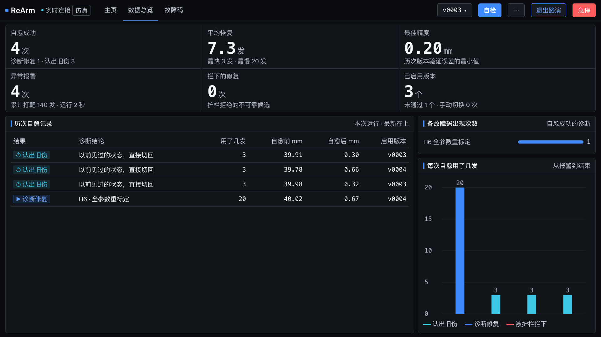 |
| 数据总览 1280×720 | 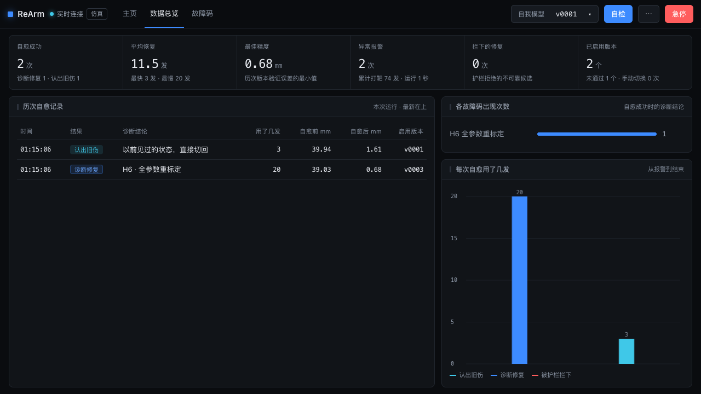 | 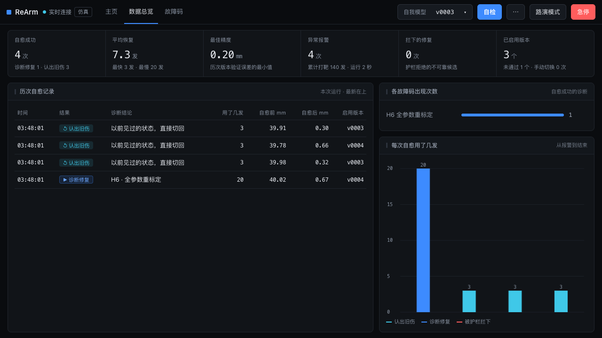 | 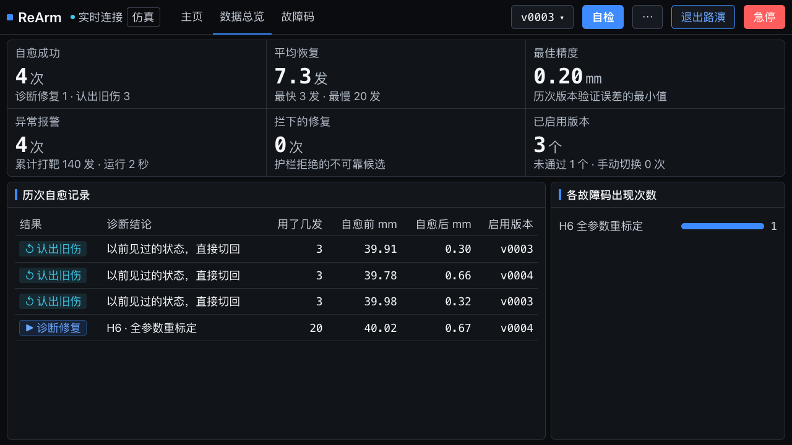 |

其它：

- 孪生姿态：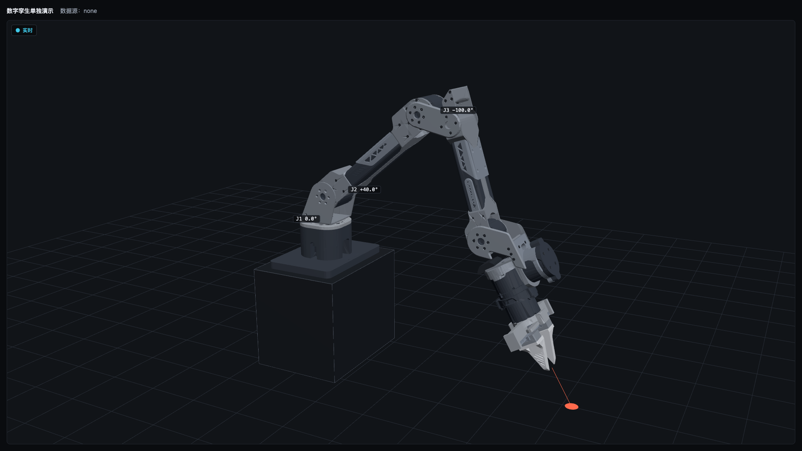
- 孪生离线：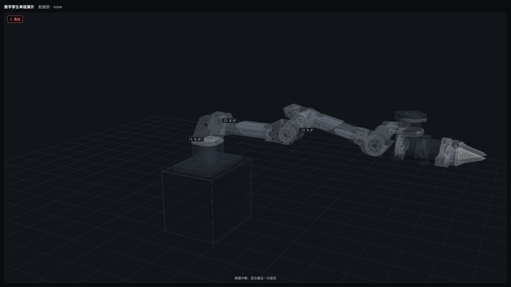
- 自愈进行中（日常模式）：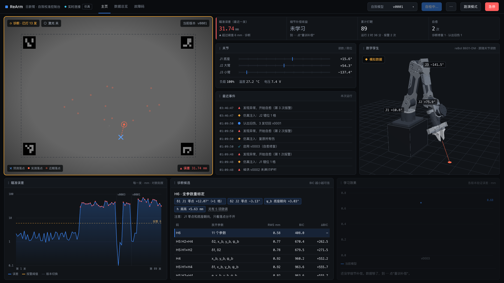
- 已急停（路演模式）：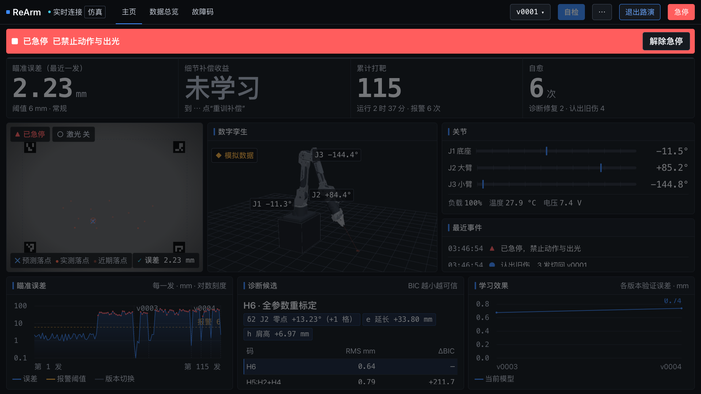

## 4. 测试结果

`.venv/bin/python -m pytest -q`：**104 通过，0 失败**（开工前 57）。新增 47 项覆盖孪生、数据源、路演模式、专注阅读、接口文档。

没有验证的：

- 真实投影仪上的观感（只在无头浏览器里按两种分辨率截图）。
- 真实下位机、真实摄像头、真机急停（按要求没有连接任何硬件）。
- 手机宽度下的路演模式（路演模式面向大屏，窄屏未专门适配）。

## 5. 需要你决定的事项（按重要程度）

1. **上位机的名义臂参数要不要改成 B601-DM**。现在仿真和标定用的是一台小臂（大臂 150、小臂 130 mm），实物是 B601-DM（264、249 mm）。孪生已按实物画，所以部分仿真姿态下末端会低于底座，我用一个 0.2 m 的安装台规避了。推荐：确认用 B601-DM 后，改 `config/arm_nominal.yaml` 并重跑评测。这是核心逻辑，我没有动。（D2、D4）
2. **下位机通信方式**。推荐 USB 串口 + 单行 JSON + CRC16，理由和代价见 D11。需要你和固件同学确认主控和接口。
3. **模型网格的许可证**。真实外形来自 Seeed 的开源硬件设计（CERN-OHL-W-2.0）。仓库不公开就没有问题；要公开或随产品分发，需确认接受该许可证，否则删掉 `modules/twin/meshes/`，自动退回简化外形。（D12）
4. **“四个栏位”“下方两块”我理解得对不对**。我按图一的四个数据格、图二的“关节”和“最近事件”处理。（D1）
5. **真机零位和 J4–J6 的姿态**。孪生里读数到模型的映射、腕部静止姿态、夹指外形都是占位。（D3）
6. **路演模式里隐藏的次要信息是否合适**（诊断表只留三列、720p 下不显示候选表等）。（D8）

## 6. 只写了方案、没有动手的大改建议

1. **演示视图与工程视图分层**。路演时观众只需要“打得准不准、伤了没有、怎么自愈的”，而诊断候选表、BIC 这些是工程细节。建议路演模式的首页只留：四个数据格、靶面画面、模型、一条“现在在做什么”的说明和误差曲线；诊断细节放到点开后的二级面板。这会改首页的信息架构，没有动。
2. **一条“现在 / 下一步”引导语**。例如“正常 · 点‘自检’打下一组”“发现异常 → 正在诊断（已打 7 发）”“已急停 → 确认安全后解除”。放在顶栏中部。它是新的交互元素，没有动。
3. **关节读数实时化**。现在关节读数和模型只在每一发之后更新。接真机后建议后端把遥测持续转发给前端（接口文档已预留），模型才能连续跟动。这要改后端数据流，没有动。
4. **一键演示脚本**。路演时按一个键自动走完“注入一处伤 → 报警 → 诊断 → 自愈”，并在每一步停顿、配说明。需要设计演示流程，没有动。

## 7. 已知问题与下一步建议

- 急停 + 路演模式 + 1280×720 同时出现时，红色横幅占掉一行，下排图表变矮，误差图的刻度标签会挤在一起。急停时页面本来就变淡，影响不大。
- 数据格里“运行 N 秒”只在快照到达时更新，仿真跑得快时会显示很小的数字。这是原有行为。
- 孪生模型的夹指是官方的尖头指，实物是白色矩形镂空指，没有 CAD。
- 路演模式没有记忆，关掉浏览器再开需要重新加 `?mode=show`（有意为之，见 D8）。

下一步建议：先定第 5 节的 1、2 两项；然后做“演示视图”方案和一键演示脚本，这两项对路演效果的提升最大。

## 8. 怎么启动、怎么看

```bash
cd /Users/superpanda/Documents/ReArm上位机
```

```bash
.venv/bin/python -m rearm.ui.server --sim --nongeometric --data-dir runtime/panel-demo
```

- 日常模式：<http://127.0.0.1:8000>
- 路演模式：<http://127.0.0.1:8000/?mode=show>（或点顶栏“路演模式”）
- 孪生用内置模拟数据循环摆姿态：<http://127.0.0.1:8000/?twin=sim>
- 只看孪生：<http://127.0.0.1:8000/static/modules/twin/demo.html>（加 `?source=manual` 可用滑块拖关节）
- 关掉孪生：`?twin=off`；只用简化外形：`?skin=simple`
- 模拟下位机联调：

```bash
.venv/bin/python scripts/mock_device.py --port 8765
```

然后打开 <http://127.0.0.1:8000/?twin=device&device=ws://127.0.0.1:8765>

- 跑测试：

```bash
.venv/bin/python -m pytest -q
```

- 重新截图验收：见 `scripts/ui_check/README.md`

其它文件：决策日志 `docs/overnight/决策日志.md`，接口文档 `docs/下位机接口文档.md`。

## 更新记录

- P0、P1 完成，报告首版。
