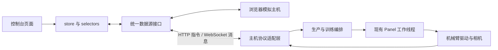

# 前后端对接方案

控制台继续使用任务书里的数据源接口，机械臂主机补一层协议适配和生产编排。页面只发“开始这套配方”等业务指令，主机负责执行、判断结果和回报进度。

本文供控制台与机械臂主机开发者核对。已存在的能力按源码标明；新增端点、字段和真机行为是实施方案，尚未实现。节点①至③仍用模拟数据，真机接入留在节点④。

五类卡点的解决办法、工单顺序和验收条件已补入[节点④设备层任务书](tasks/节点4-设备层与后端接入任务书.md)。真机采用独立 v2，旧训练和节点①模拟 v1 保留；本方案的建议已按该任务书同步，未修改正式协议和运行代码。

## 1. 怎么接



| 位置 | 负责什么 | 对外约定 |
|---|---|---|
| 页面 | 交互、确认、数字和孪生 | 不直接请求网络，不控制电机 |
| 数据源 | 连接、校验、发送、重连 | `start / stop / subscribe / send` |
| store | 合并消息、去重、统计 | `reduce(state, message)` 为纯函数 |
| 主机协议适配层 | 格式转换、应答、快照、媒体地址 | 真机 v2；数据源转换为页面内部事件 |
| 主机编排 | 自检、识别、配方执行、检查、训练 | 真实阶段变化时发消息 |
| Panel 与驱动 | 串行动作、限位、急停、遥测 | 机械臂只有一个控制所有者 |

推荐在机械臂主机提供控制台静态文件、API 和图片流，让浏览器访问同一来源。两台电脑调试时可以跨源，但必须配置准确的 Origin、HTTP 预检和 WebSocket 来源检查。现有远端 HTTP 服务默认只监听本机，不能把它当作已经可供局域网访问。

新增服务建议复用一份 `Panel` 实例和它的设备工作线程，不另开一个驱动抢占串口。生产流程执行期间，旧调试面板的普通运动命令也必须受同一个忙碌状态约束。急停保持独立入口，不排在普通动作后面。工作线程内部不能提交命令后等待自己的队列。

GitHub 仓库已经声明 FastAPI、Uvicorn 为可选 UI 依赖，可以评估用独立入口承载新协议；现有服务实际上是标准库 HTTP 服务。是否采用该入口、WebSocket 运行依赖是否齐备，留给后端确认，不需要先替换现有服务框架。

## 2. 当前接口不能直接互接

核对基线：本地提交 `22ef835`；GitHub `main` 提交 [245491f](https://github.com/lizuyi-6/ReArm/tree/245491fd1568d3c8e07e2b02b3832ab04af42264)。本地控制台为 T1 外壳阶段，后续施工可能继续增加实现。

| 项目 | 本地控制台约定 | GitHub 后端当前实现 |
|---|---|---|
| 状态 | WebSocket，带 `v/type/seq/t` | `GET /api/state` 返回完整状态 |
| 指令 | `POST /api/v1/command`，字段 `cmd` | `POST /api/cmd`，字段 `action` |
| 应答 | `v/seq/ok/code/msg` | 通常为 `ok/detail` |
| 页面连接 | 真主机入口留到节点④ | 标准库 HTTP，无控制台 WebSocket 路由 |
| 生产 | `run_start` 和配方状态消息 | 有 `start_work`、`recognize`、`pick` 等单项动作 |
| 视频 | 从 hello 取得地址 | 彩色、深度 MJPEG 及识别叠图 |
| 训练和文档 | 零件、配方、轮次、版本 | 有零件配置和识别模型，未见该业务 API |

旧 `host-source.js` 已实现 WebSocket 收消息和 HTTP 发指令，但它为训练页面服务，当前新控制台尚未加载。节点④可复用其传输思路，补控制台能力校验与恢复逻辑，不能直接把 GitHub 主机地址填进去就认为接通。远端 README 仍描述早期骨架，本次接口判断以当前源码为准。[后端 HTTP 入口](https://github.com/lizuyi-6/ReArm/blob/245491fd1568d3c8e07e2b02b3832ab04af42264/rearm/ui/server.py#L2340)

## 3. 哪些能力能复用

| 控制台需要 | 可复用的后端能力 | 还需补的部分 |
|---|---|---|
| 连接与自检 | `connect`、遥测、相机状态 | 通信、J1 至 J6、夹爪、相机的 9 项结果 |
| 到观察位 | `goto_work_start`、轨迹存储与回放 | 确定共用轨迹、相机垂直观察位及版本 |
| 识别 | `recognize`、`vision.last.detections` | 工装和定位柱、框、帧关联、置信度定义 |
| 抓取 | `pick` 的规划、夹爪和到位检查 | 分阶段事件、对象实例 ID、面向装配的后续动作 |
| 放到定位柱 | 运动与视觉定位基础能力 | 指定装配目标、放置规划及失败处理 |
| 装配检查 | 相机拍照、深度和视觉基础能力 | 装配到位判断、偏差定义和有效性 |
| 回折叠位 | `home`、初始姿态记录 | 失败、急停、持物时是否允许回位 |
| 零件文档 | `config/parts/part-*.json` | 外部 ID、版本、训练记录、图片资源 |
| 配方与训练 | 现有算法和模型可评估复用 | 配方持久化、异步任务、进度及自动入库 API |
| 急停 | 独立的 `Panel.estop()` | 控制台急停锁存、任务取消与明确恢复条件 |

`start_work` 当前只做“必要时使能、到工作位、识别”。`pick` 默认抓起后放回原处，不会装到另一处的定位柱；`place_back:false` 也只是跳过放回，不能视为完成放置。不能把这两个 action 改个名字就当成 `run_start`。[动作实现](https://github.com/lizuyi-6/ReArm/blob/245491fd1568d3c8e07e2b02b3832ab04af42264/rearm/ui/server.py#L1280)

还有一个应答陷阱：现有 `pick` 在“未夹到”时也可能返回 `ok:true`，实际结果在 `last_pick.held`。新接口必须区分“指令接受”和“业务成功”，不得用 HTTP 200 或 `ok:true` 增加完成套数。[现有测试明确覆盖此行为](https://github.com/lizuyi-6/ReArm/blob/245491fd1568d3c8e07e2b02b3832ab04af42264/tests/rearm/test_ui_server.py#L1235)

## 4. 接线前必须统一的字段

### 4.1 关节、坐标和夹爪

| 项目 | 发现的差异 | 对接要求 |
|---|---|---|
| 关节数组 | 后端遥测 7 项，前端要求 6 项 | 前 6 项接 `q/dq`，J7 独立转换为夹爪开口 |
| 角度和长度 | 后端 rad/mm，前端场景内部 m | 线上统一 rad/mm，渲染层只转换一次 |
| 关节范围 | 前端已同步后端 PANEL_LIMITS（2026-11-15） | J2 上限 0.3、J3 上限 0.05、J4 上限 1.95 rad；不能裁剪真实读数 |
| 末端参考点 | 前端 TCP 已与后端 `pick.frames()` 名义夹头重合 | 抓取用 tip；`kin6.fk()` 的 `tool_x=-105 mm` 不是夹头 |
| 夹爪全开 | 前端与后端均为 110 mm（2026-11-15） | 单指行程 55 mm，来源为后端 245491f 的 gripper.json |
| 夹爪开口 | 后端记录齿轮打滑，绝对 J7 零位会漂移 | 用本次有效标定换算，无参考时 `null` |
| 关节载荷 | 后端为 `tau_nm`，旧协议为 `current` A | 不把力矩填进电流，新增力矩字段或保留缺测 |
| 夹持力 | 演示文档约 12 N，后端用力矩阈值 N·m | 分别记录，换算须有机构与标定依据 |
| 温度 | 后端有 MOS 和转子两种温度 | 明确显示哪种，不能混成不注明来源的温度 |

纯数学核对已运行：原 FK 对照的 3 组角度，加工作位 `[1.6405,-1.6608,-2.2757,1.8915,-0.0063,0.1276]`，前端 `end_link` 与后端 `pick.frames(q)[1]` 的完整 4×4 位姿一致，最大位置差 `3.69×10⁻¹³ mm`、朝向差 `5.62×10⁻¹⁴°`。前端已去掉局部 X 的 0.5 mm 偏移，`T_end_tcp` 为单位矩阵。抓取实际使用的名义夹头是 `base·DH1..6·TOOL_DH`；`kin6.fk()` 另沿夹头 X 后退 105 mm，该点不是夹头，不能直接作为抓取 TCP。`TABLE_TIP_Z_MM=3.6` 表示夹头碰桌时的基座 Z 约 3.6 mm，不是要加到局部 TCP 上的偏移。

相机采用后端 `config/handeye_camera.json` 的 `T_tip_cam`，平移从 mm 换为 m。前端相机约定为 X 前、Y 左、Z 上，后端 OpenCV 为 x 右、y 下、z 前；因此 `T_end_camera = T_tip_cam · R_cv_render`，其中 `R_cv_render` 的三列为 OpenCV 的 `[+Z, -X, -Y]`。光心安装位从 `[-69.5, 0, 40] mm` 改为 `[-68.814228, 36.191124, 55.202707] mm`，并采用完整标定旋转。工作位的相机光心和三根轴已与 `frames(q)[1]@T_tip_cam` 比较，四组最大误差为 `3.91×10⁻¹³ mm / 5.10×10⁻¹⁴°`。

两条夹指渲染路径共用后端尺寸：Z 厚度 40 mm、V 槽边长 15 mm、夹角 90°、深约 10.61 mm、口宽约 21.21 mm、V 下方平条 0 mm。两指沿 Y 对向移动，闭合组成菱形，全开仍为 110 mm。X 长度保留 65 mm，长度待尺量；Y 外宽沿用 STEP 的 25 mm，显示网格省略孔位细节，原 STEP 文件保留。

以上只证明名义模型一致，不是实机标定精度。手眼配置记录求解 RMS 为 6.9 mm，并注明在工作位附近有效；手指长度、安装实测及相机外壳尺寸仍待确认。核对脚本为 `scripts/check_twin_vs_backend.py <后端目录>`，不修改后端。完整位姿、改前误差与来源哈希见 [孪生对照](接口核对/孪生对照.json)；[原 FK 对照](接口核对/FK对照.json) 保留为历史数据。

后端记录的工作位 J4 为 **1.89155 rad**；前端已将 J4 上限同步为后端 Panel 的 **1.95 rad**（2026-11-15），不再因旧显示限位判为 `out_of_range`。显示配置不替代硬件限位保护。[工作位记录](https://github.com/lizuyi-6/ReArm/blob/245491fd1568d3c8e07e2b02b3832ab04af42264/config/work_start_pose.json)、[后端限位](https://github.com/lizuyi-6/ReArm/blob/245491fd1568d3c8e07e2b02b3832ab04af42264/rearm/ui/server.py#L53)、[夹爪配置](https://github.com/lizuyi-6/ReArm/blob/245491fd1568d3c8e07e2b02b3832ab04af42264/config/gripper.json)

旧协议把电流、速度等任一缺测都归成该轴 `valid:false`，但真机目前没有独立电流字段。这会让有效关节角也被判无效。真机 v2 区分位置有效性、范围告警与可选遥测的有效性；旧训练 v1 保留原义。字段与验收见节点④任务书 D1。

### 4.2 识别结果和零件 ID

后端目前输出分类 `distance/margin`、中心和角度，未提供协议要求的概率置信度、目标实例 ID 与轴对齐框。不能把距离改名为置信度，也不能填固定的 0.99。建议在识别阶段从实际轮廓生成 `box_px`，置信度若未定义则明确缺失，并同步确认前端如何显示。[识别输出](https://github.com/lizuyi-6/ReArm/blob/245491fd1568d3c8e07e2b02b3832ab04af42264/rearm/vision/parts.py#L329)

区分零件类型 `part_id` 与本帧物体实例 `target_id`。同类零件可能有多个，单用类型 ID 会抓错实例。抓取角度取实际夹爪闭合方向，不能直接套用物体长轴角度；定义为图像坐标系角度，并说明零方向、正方向、周期和画面尺寸。按清单要求，角度只在当前抓取步骤显示，不进入零件文档或生产历史。

后端零件 1 至 4 的名称为“大尺寸扁片、短轴、长轴、异形零件”，与模拟库里的“薄片、空心圆柱、短轴套、方垫块”并非已确认的一一对应。真机接入前建立经确认的 ID 对照，不能按名称相近自动替换。

## 5. 接口文档怎么写

T2 已在 `docs/接口文档.md` 附录 C 定义模拟控制台 v1，保留该内容。节点④另建 `docs/接口-控制台真机-v2.md`，按设备层任务书 D0 冻结契约；本轮不直接改正式协议。

| 章节 | 必须写清楚 |
|---|---|
| 范围与能力 | 模拟、真机、旧训练接口各支持什么 |
| 端点与部署 | HTTP、WS、媒体路径，地址来源、跨源、控制权限 |
| 公共规则 | 字段类型、单位、必填、null、ID、时钟、版本 |
| 指令 | 前置条件、参数、接受应答、完成事件、错误、幂等 |
| 消息 | 每种字段表、触发时机、关联对象、更新与覆盖规则 |
| 对象文档 | 零件、配方、工装、训练记录、模型及资源版本 |
| 状态时序 | 成功、失败、急停、断线、重连、重启 |
| 映射与验收 | 页面字段对应来源、真实缺口、双方契约样例 |

每个指令至少给成功和失败各一例；每类测量至少给有效、缺测各一例。文档里的“支持”要有实现或测试依据，只有模拟实现的标明范围。

### 5.1 端点建议

以下新端点尚未在 GitHub 后端实现；事件路径、快照和查询路径需双方确认。

| 方向 | 路径 | 用途 |
|---|---|---|
| 浏览器 → 主机 | `POST /api/v2/command` | 提交业务操作，返回接受结果与任务 ID |
| 主机 → 浏览器 | `WS /api/v2/events` | hello、遥测、阶段、结果、心跳 |
| 浏览器 → 主机 | `GET /api/v2/snapshot` | 取得一致的当前状态和统计基线 |
| 浏览器 → 主机 | `GET /api/v2/commands/{request_id}` | 断线后查询未知执行结果，不盲目重发 |
| 浏览器 → 主机 | 现有相机流及受控媒体路径 | 彩色、深度、识别图片、训练录像 |

现有彩色与深度路径分别是 `/api/camera/color.mjpg`、`/api/camera/depth.mjpg`，识别叠图为 `/api/vision/overlay.jpg`。新 hello 应返回浏览器可访问的 URL，不返回主机磁盘路径。若前端在另一台电脑，主机返回 `localhost` 会指向浏览器自己的电脑，不能照搬。

### 5.2 公共信封建议

旧训练及模拟 v1 不变。真机推送使用 `v:2/type/session_id/seq/t`；请求使用 `v:2/cmd/request_id/seq/t`；应答使用 `v:2/request_id/seq/accepted/code/msg/run_id/train_id`，无关联任务的 ID 为 null。命令参数仍放顶层，与现有 `send(cmd,args)` 一致。

以下字段归入真机 v2，由 hello 声明实际能力。数据源必须先校验线上版本，再映射到内部状态，不能仅修改版本号绕过校验。

| 字段 | 定义 | 解决的问题 |
|---|---|---|
| `capabilities` | 主机实际实现的控制台能力集合 | 连得上不代表能生产或训练 |
| `session_id` | 主机本次启动的唯一标识 | 重启后 seq 从头开始不被旧数据压住 |
| `request_id` | 一次业务请求的全局唯一字符串 | 双击、重试和跨标签页不能重复启动 |
| `run_id / train_id` | 主机分配的运行、训练 ID | 迟到结果不会写入下一轮 |
| `snapshot_seq` | 快照覆盖的事件序号 | 接快照后只应用更晚的事件 |
| `model_version / calibration_id` | 本轮使用的模型、标定标识 | 记录可追溯，不能中途悄悄换模型 |

推送 `t` 用 Unix 毫秒；后端 `server_time` 当前为 Unix 秒，需要转换。相机和遥测内部单调时钟只适合算时长与新鲜度，不能直接当 Unix 时间。耗时由主机本地计时产生。

请求相同 `request_id` 且内容相同，返回原执行结果；同 ID 不同内容应拒绝。动作超时或断线只说明结果未知，不能自动再次抓取。去重记录保留多久、主机重启后如何恢复，需要一并写进文档。

```json
{"v":2,"cmd":"run_start","seq":12,"t":1794700000000,"request_id":"req-example-001","recipe_id":"recipe-example","recipe_version":1}
```

```json
{"v":2,"seq":12,"accepted":true,"code":"accepted","msg":"已接受","request_id":"req-example-001","run_id":"run-example-001","train_id":null}
```

以上是建议格式样例。应答只确认接受；实际成功由后续结果决定，不能在这里增加完成计数。

### 5.3 从模拟消息映射到真机消息

下表左列是节点①模拟协议的现有消息，供字段覆盖核对；真机生命周期按节点④ D0/D5 实施，检查记账使用 `run_result`，收回终态使用 `run_finished`，不沿用一个 `run_done` 同时表示两件事。

| 消息 | 保留 A.6 的内容 | 正式文档要补齐 |
|---|---|---|
| `run_state` | 运行、配方、phase、步骤、当前零件 | 步骤从 1 计数；空闲引用用 null；失败与取消如何结束 |
| `selfcheck_item` | run_id、9 类 item、ok | 未检查不等于失败；原因、检查时间、有效期限 |
| `recognition` | 图像尺寸、目标种类、框、角度 | frame_id、拍摄时间、图片 URL、类型 ID 与实例 ID |
| `step_state` | pick/place、started/done、角度、夹持力 | step ID、目标工装位置、失败结果、力的来源 |
| `inspect_result` | ok、deviation_mm | 是否测量有效、测量方式、阈值、无效原因 |
| `run_done` | 运行、配方、结果、偏差、耗时 | 去重键、完成时间、记录版本、归位是否完成 |
| `library` | 零件和配方摘要 | 明确是全量替换；库 revision；稳定 ID |
| `part_doc / recipe_doc` | 清单要求的完整文档 | 字段表、版本、资源 URL、数据来源、缺测规则 |
| `part_candidate` | 轮廓、尺寸、名称、编号 | 轮廓坐标系、尺寸定义、候选 ID、请求关联 |
| `train_progress` | 轮次、偏差、试抓、图像数、耗时 | target ID、测量口径、样本数累计规则、终止条件 |
| `train_done` | train_id、doc_id | 对象类型、文档版本、完成时间及库更新顺序 |

`inspect_result` 区分 pass、fail、unknown，未测到时 `deviation_mm:null`。按节点④ D2，首页偏差取本套零件最大径向偏差，另测落座误差，并检查存在性与顺序；公差和测量误差预算由实测确定。现有抓取 `tip_error_mm` 是名义运动学到位误差，不能充当最终装配偏差。

生产工序仍按总体清单，检查后还有收回。真机 `phase` 与 `status` 分开，后者为 running、succeeded、failed、cancelled、estopped；收回失败保留检查结果，整项操作为 failed。只有主机明确 ready 才能再次开始，不能遇错直接显示“待命”。

训练不保证每轮偏差下降。真实主机必须上报实际值，不能沿用模拟主机“固定 8 轮完成”的时间线。重新训练要携带原对象 ID 与基准版本，成功后更新同一对象的版本；不能每次都新建一件零件。

### 5.4 零件、配方文档字段

| 对象 | 最小字段组 |
|---|---|
| 零件摘要 | id、名称、编号、版本、收录时间、缩略图 |
| 零件详情 | 摘要、外形资源、轮廓、尺寸、开口策略、夹持力与估算依据 |
| 零件训练记录 | train_id、每轮偏差和试抓结果、阈值、图像数、耗时、模型版本 |
| 配方摘要 | id、名称、版本、收录时间 |
| 配方详情 | 工装 ID、顺序步骤、每步零件 ID 与装配目标、关联零件版本 |
| 配方训练记录 | 每轮装配偏差、成功数与总数、阈值、用时、模型版本 |

角度和运动轨迹不进入上述业务文档。固定观察、折叠轨迹由主机维护，并在执行记录里保留轨迹版本。训练录像有文件才返回 URL；没有就省略，不挂空链接。新建与重训的 `train_start.draft` 必须分别定义，不能只有“任意对象”四个字。

生产记录按 `run_id` 去重，训练记录按 `train_id` 去重。一次通过率按“首次检查明确通过 / 已执行首次检查”计算，unknown 不算通过；检查前失败、取消、急停单列。真机清显示统计不删除历史、不触发运动；记录由主机保存，刷新后从快照或历史恢复。详见节点④ D2/D4。

## 6. 一次生产怎么走

1. 连接收到 hello，核对能力、硬件配置和完整快照后，才允许开始。WS 打开本身不等于设备可运行。
2. 用户选配方并二次确认，前端只发一次 `run_start`。主机校验版本、设备状态、互斥任务，返回 request_id 与 run_id。
3. 主机执行自检、到观察位、识别；按真实阶段发送 `run_state`、自检和识别结果。
4. 主机按配方抓取、放置，发步骤事件和真实关节遥测。前端不按计时器猜阶段，不从中文日志解析动作完成。
5. 主机回观察位检查，以 run_result 记录测量与检查结论，再收回并发 run_finished；前端仅在主机明确 ready 后恢复开始按钮。

急停走独立高优先级入口，同时取消当前生产或训练的后续动作。现有 `estop` 是下使能，可能使关节失去保持；它不是模拟器的“原姿态冻结”。`reset_estop` 不能直接映射为现有 `enable`，因为 `enable` 可能自动运动回初始位。真机解除、重新使能、归位应分别定义并实测，清空演示记录不隐式触发运动。[使能与回位](https://github.com/lizuyi-6/ReArm/blob/245491fd1568d3c8e07e2b02b3832ab04af42264/rearm/ui/server.py#L867)、[急停实现](https://github.com/lizuyi-6/ReArm/blob/245491fd1568d3c8e07e2b02b3832ab04af42264/rearm/ui/server.py#L2180)

现有急停接口捕获下使能异常后仍返回 `ok:true`，异常写在 detail 内。适配层不能据此宣称机械臂已停稳；新约定需分别表达“请求已受理”“驱动回报”和“物理状态未知”。

断线后前端保留最后姿态并标记过期，不自动切回模拟，不重发动作。主机如何停止后续流程、保持或释放负载，要由硬件负责人确定；不能照搬模拟器的停机行为。重连时按 session_id 重建状态并恢复快照，不自动恢复生产。

## 7. 前后端分别做什么

| 阶段 | 前端 | 主机后端 | 交付检查 |
|---|---|---|---|
| 节点① T2 | 按 A.6 完成模拟、store、文档扩展 | 提供字段与能力反馈 | 模拟契约样例一致 |
| 节点④准备 | 固定页面读取字段，整理所需事件 | 确认 ID、单位、范围、失败和恢复规则 | 双方确认一份协议及样例 |
| 只读接通 | 新增真机数据源；接 hello、状态、画面 | 提供适配层、快照、媒体、设备配置 | 有效、缺测、断线均正确显示 |
| 单次生产 | 只发送业务指令，显示真实阶段 | 补生产编排、放置、检查、取消 | 假驱动先跑全链，随后安排真机验收 |
| 文档和训练 | 接真实库、进度、重训、历史 | 持久化、训练任务、版本和媒体资源 | 刷新、重连后文档与记录不丢 |

前端接入点放 `modules/datasource/` 和 `console/main.js`，页面保留 `store + send`。零件模型、工装坐标和孪生显示只消费主机数据，不负责决定机械臂如何运动。后端协议适配与业务编排应单独成模块，避免继续把新职责全部塞进现有的大 `server.py`。

## 8. 双方确认后再冻结的事项

| 事项 | 需要确定的具体内容 |
|---|---|
| 部署 | 服务入口、端口、静态资源位置、Origin、控制权限、旧面板写入互斥 |
| 硬件坐标 | TCP、相机变换、显示限位、110 mm 夹爪范围及标定版本 |
| 配方与工装 | 零件 ID 对照、定位柱识别、装配目标和动作支持范围 |
| 测量 | 置信度定义、装配偏差含义、阈值、力与力矩的来源 |
| 生命周期 | 错误终态、急停恢复、断线行为、重训、幂等及记录保存 |

## 9. 联调通过的标准

| 检查 | 应有结果 |
|---|---|
| 协议样例 | 同一批 JSON 样例分别通过前端校验和后端模型校验 |
| 关节与坐标 | 6 轴和 J7 正确分离；已确认的工作位可显示；TCP 定义相同 |
| 缺测 | 无电流、无深度、相机过期都不补 0、不伪造成功 |
| 请求与结果 | 重复 request_id 只启动一次；未夹到不计成功；超时可查询 |
| 完整流程 | 自检、两次抓放、检查、收回均由真实事件驱动 |
| 急停 | 长动作中仍可受理；后续动作被取消；解除不会偷偷归位或续跑 |
| 恢复 | 刷新、重连、主机重启后不重复计数、不沿用旧任务状态 |
| 文档与训练 | 新增和重训正确区分，版本更新，失败不自动入库 |
| 画面 | 框对应同一帧，URL 从浏览器设备可达，画面与坐标尺寸一致 |

本轮验证只有源码核对及纯数学 FK 对照；没有连接设备、启动远端服务或执行真机动作。主机端测试文件用于理解既有行为，本轮没有运行其测试套件。

## 10. 后端 R61 变化（2026-11-14 交接，对接时以此为准）

来源：后端 R61 交接摘要。R61 改动在后端仓库**尚未提交**，下面的行号指交接时的工作区，不是上面引用的 245491f。

**接口与数据**
- `last_pick` 新增三个字段：`tip_errors_mm`（每次下探到位的指尖误差，数组）、`feedforward_deg`（二次下探用的逐关节前馈，度）、`retry_refused`（二次下探后仍被闸门拒绝）。前端 `step_state` 的失败原因可直接映射这三项，`held` 仍是唯一的“夹到”依据（见第 3 节应答陷阱）。
- 抓取改为最多两次下探：第一次到位后指尖误差 > 5 mm 时，按第一次残差加前馈（每关节 ≤ 0.10 rad）再下探一次。一次 pick 的耗时与阶段数会变长：下探 → 拒绝 → 回悬停 → 补偿再下探 →（通过则闭合 / 拒绝则回悬停、回工作位、夹爪合拢）。模拟时间线（现有前端接口规范 第 377 行起）需按此加“重试”阶段，或由后端发阶段事件。
- 闭合闸门 `PICK_TIP_TOL_MM = 5.0` 未改。它是抓取到位门槛，**不是**页面「偏差阈值」（设置页当前 1.0 mm，指装配检查偏差），两者不要混用。
- `/api/state` 有 `enabled`（布尔）和 `pose_error_deg`，可接到顶栏连接/使能状态和设置页。
- 夹爪力矩参考由 `gripper_calibrate` 运行时写入 `config/gripper.json`：贴紧 9.3338 rad、张开 2.7274 rad。这是 J7 力矩/位置参考，不是开口 mm；开口换算仍按 4.1 节，用本次有效标定。

**真机上电顺序**（每个动作单独 `POST /api/cmd` 一次，对应前端「自检 → 到观察位 → 识别 → 抓取」）：`connect` → `gripper_apply` → `enable` → `gripper_calibrate` → `start_work` → `recognize`（带 save）→ `pick`（`part_id`、`open_mm`）。前端 `run_start` 编排时不能跳过 `gripper_calibrate`。

**安全缺口（接入前必须知道）**
- 下探时**没有碰撞中止**，撞到东西不会自动停（阻断级）。前端急停按钮是唯一软件停止入口，联调时必须有人在实体急停旁。
- 带补偿的闭合、抬起、放回在真机上**一次都没跑过**；补偿只在 #3 法兰长轴套一个位姿测过（指尖误差 13.9 → 5.6 mm，仍未过闸门）。
- 闸门是否放宽（方案 A 分轴 5 mm / B 再迭代补偿 / C 提高 J4 kp）由用户决定，后端不要自行修改阈值或 kp。

## 依据

- [总体施工清单](施工清单.md)：四个节点、生产流程、文档内容和真机接入边界。
- [节点①任务书](tasks/节点1-任务书.md)：A.3、A.6、T2、T4 的接口与职责。
- [现有接口文档](../接口文档.md)：旧 v1 信封、单位、传输与兼容规则。
- [前端真实数据源](../../rearm/ui/static/modules/datasource/host-source.js)、[机械臂参数](../../rearm/ui/static/modules/arm/arm-params.js)、[FK](../../rearm/ui/static/modules/arm/fk.js)。
- [后端服务源码](https://github.com/lizuyi-6/ReArm/blob/245491fd1568d3c8e07e2b02b3832ab04af42264/rearm/ui/server.py)、[视觉输出](https://github.com/lizuyi-6/ReArm/blob/245491fd1568d3c8e07e2b02b3832ab04af42264/rearm/vision/parts.py)、[运动学](https://github.com/lizuyi-6/ReArm/blob/245491fd1568d3c8e07e2b02b3832ab04af42264/rearm/model/kin6.py)、[抓取几何](https://github.com/lizuyi-6/ReArm/blob/245491fd1568d3c8e07e2b02b3832ab04af42264/rearm/task/pick.py)。
